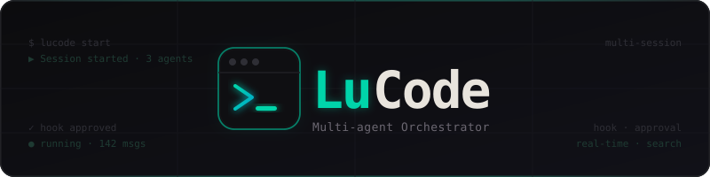

<p align="center">
  
</p>

<p align="center">
  <b>Multi-agent orchestrator for AI-assisted development</b><br/>
  Run multiple AI coding sessions simultaneously from a single, elegant interface.
</p>

<p align="center">
  
  
</p>

---

## What is LuCode?

LuCode gives you a browser-based control panel for AI coding agents. Instead of switching between terminal windows or losing context between sessions, you can open projects, start conversations, and let multiple agents work in parallel — all visible from one place.

Think of it as a mission control for your AI workflow.

**Currently works with [Claude Code](https://claude.ai/code)** — Anthropic's CLI for AI-assisted development. Support for other AI CLI tools is planned (see [Roadmap](#roadmap)).

---

## Features

| | |
|---|---|
| **Multi-session** | Run several AI agents at once across different projects |
| **Real-time streaming** | Watch the agent think, plan, and work as it happens |
| **Hook approval** | Review and approve every tool call before it executes |
| **Global search** | Full-text search across all sessions and messages |
| **Starred messages** | Bookmark key responses for quick reference |
| **Voice I/O** | Speak your prompts, hear the responses read back |
| **Diff viewer** | Monaco-powered side-by-side diffs for file changes |
| **Dark UI** | Terminal-native aesthetic, built for long sessions |

---

## Getting Started

### Requirements

- **[Claude Code](https://claude.ai/code)** — install this first. LuCode orchestrates it.
- Linux, macOS, or Windows (x86-64)

### 1 — Download

Grab the binary for your platform from the [Releases](#) page:

| Platform | Binary |
|---|---|
| Linux | `lucode-linux` |
| macOS | `lucode-mac` |
| Windows | `lucode.exe` |

Each binary is self-contained — no dependencies, no runtime, no Docker.

### 2 — Install

```bash
# Linux / macOS
chmod +x lucode-linux
./lucode-linux install

# Windows
lucode.exe install
```

The installer will:

1. Verify Claude Code is installed
2. Copy LuCode and its hook to `~/.lucode/`
3. Write `~/.lucode/settings.json` with the hook registered
4. Optionally add `~/.lucode` to your `PATH`

> LuCode does **not** modify your `~/.claude/settings.json`. It creates its own isolated settings file.

### 3 — Run

```bash
lucode --port 8090 --working-dir ~/projects
```

Open **http://localhost:8090** in your browser and create your first workspace.

### Options

```
--port           HTTP port to listen on          (default: 8090)
--working-dir    Base directory for workspaces   (default: none)
--data           Where to store the database     (default: ~/.lucode)
--claude-settings  Path to Claude settings file  (default: ~/.lucode/settings.json)
```

---

## How It Works

```
Browser  ──WebSocket──▶  LuCode server  ──spawns──▶  claude CLI
                              │                           │
                         SQLite DB               lucodehook (PreToolUse)
                              │                           │
                         Streams events  ◀──approval──  UI
```

LuCode spawns a `claude` process per session, streams its output over WebSocket to your browser, and intercepts tool calls via a hook binary (`lucodehook`) so you can approve or deny them in real time.

---

## Roadmap

- [ ] Support for **Gemini CLI** and other AI tools
- [ ] Multi-user sessions
- [ ] Session export / replay
- [ ] Plugin system for custom tool handlers

---

---

## Technical

<details>
<summary><b>Building from source</b></summary>

### Requirements

- Go 1.22+
- Node.js 18+
- `git`

### Build

```bash
git clone https://github.com/your-org/lucode
cd lucode

./build.sh
```

This produces three binaries in `dist/`:

```
dist/
  lucode-linux    # Linux x86-64
  lucode-mac      # macOS x86-64
  lucode.exe      # Windows x86-64
```

Each binary includes the web UI and `lucodehook` embedded — no separate files needed.

### Build order

The build script handles the order automatically:

1. **Web** — `npm run build` → `web/dist/`
2. **lucodehook** — compiled for each target platform and embedded into lucode
3. **lucode** — compiled with web UI + hook baked in via `//go:embed`

### Dev mode

For local development, run the backend and frontend separately:

```bash
# Backend (no web embed needed)
go build -o orchestrator ./cmd/orchestrator
./orchestrator

# Frontend (Vite dev server with proxy)
cd web && npm run dev
```

The Vite dev server proxies `/api` and `/ws` to `:8090` automatically.

</details>

<details>
<summary><b>Project structure</b></summary>

```
cmd/
  lucode/          Main binary (server + install + embed)
  lucodehook/      Hook binary (embedded into lucode at build time)
  orchestrator/    Legacy dev-only server (no embed)

internal/
  api/             HTTP handlers and SPA serving
  db/              SQLite schema and queries
  session/         Claude process management
  ws/              WebSocket hub
  hookconfig/      Claude settings.json writer

web/
  src/             React + Zustand frontend
  public/          Logos and static assets
  embed.go         Go embed entrypoint for web/dist
```

</details>

<details>
<summary><b>Contributing</b></summary>

1. Fork and clone the repo
2. Follow the dev mode setup above
3. Read `CONTEXT/index.md` — each subsystem has a dedicated context file
4. Open a PR with a clear description of what and why

**Key constraints:**

- After any Go change: rebuild and restart the server
- `pending_hooks` table is ephemeral — dropped and recreated on each server start
- Zustand selectors returning objects/arrays must use stable module-level references (not `?? []`) to avoid infinite re-renders
- Frontend uses relative API URLs — no hardcoded ports

</details>
